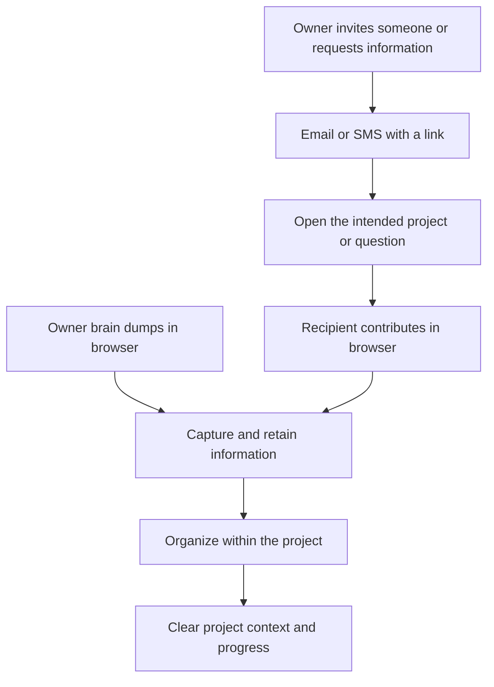

<!-- docs/plans/buildos-one-project-trial-and-multiplayer_2026-10-14.md -->
<!-- doc-status: point-in-time -->

> **Point-in-time planning note.** Written 2026-10-14. Captures proposed product direction,
> not current implementation. Architecture implications below are provisional.

# BuildOS one-project trial and frictionless multiplayer

## 1. Core insight

BuildOS's strongest experience is being able to brain dump information as if talking to a
friend or consultant, have that information stored, and see it organized into a project.
The user can start with a rant instead of having to arrive with a plan.

The priority is to make this experience exceptionally easy to try and useful quickly:
**get thoughts out, see them organized, gain clarity, and make progress on a real project.**

Managing multiple projects adds complexity. The first experience should concentrate on one
project so the user can feel the value before taking on more. Multiplayer should extend the
same experience to other people's knowledge, with very little friction between receiving a
request and contributing information.

## 2. The two priorities

### Brain dumping that becomes an organized project

- Let people explain things naturally, including messy, incomplete thoughts and long rants.
- Store the information so it remains useful after the conversation.
- Organize it into a project quickly and cleanly.
- Make the result visible and understandable: the user should see where their information went.
- Help the user gain clarity and move the project forward.

The value is the combination of being heard, having the information retained, and seeing
useful project structure emerge from it.

### Sharing and multiplayer that feel easy

- Make inviting someone into a project frictionless.
- Support both email invitations and invitations delivered by text message.
- Let the recipient click a link and land directly inside the relevant project or question.
- Avoid a conventional login or onboarding detour in the intended recipient experience.
- Keep contributions organized within the project as more people participate.

Email and SMS are two entry points into the same browser experience. The proposed question
flow is to receive a message, open the link, and answer in BuildOS.

## 3. The one-project trial

Offer a free trial in the browser where someone can bring a real project, brain dump about
it, and try managing that one project within BuildOS.

The intended pitch, as stated in the brainstorm:

> “If you don't get clarity and make progress on your project, no problem. If you want to do
> multiple projects or something like that, you buy and pay for BuildOS.”

The commercial direction is to demonstrate value through one project and make expansion
to multiple projects a reason to pay. The exact trial period and paid limits remain open.
This does not yet settle whether a single project stays free indefinitely or what happens
when a timed trial ends.

### Intended first experience

1. Open BuildOS in the browser and start with one project.
2. Explain the project naturally, as if talking to a friend or consultant.
3. See the information stored and organized into a clear project.
4. Continue adding context and using the project to make progress during the trial.
5. Upgrade when the user wants to expand into multiple projects or other paid capabilities
   that are still to be defined.

The trial should prove the core experience through the user's own information. Clarity and
progress are the desired outcomes; creating an account or generating a project alone does
not establish that the experience worked.

## 4. Two multiplayer flows

### Flow A: Invite someone into a project

1. A project owner chooses someone to invite by email or phone number.
2. The person receives an email or text message containing a link.
3. They open the link and arrive at the intended project, with minimal friction.
4. They can participate within the access granted to them.
5. Their information becomes part of the shared, organized project.

The desired experience is: **“I received the invitation, clicked, and I'm in the project.”**
The membership, identity, and permission details still need design.

### Flow B: Ask someone for specific information

This is a focused request for knowledge. It should not require someone to learn the whole
project before helping.

1. A project owner identifies a question or missing information in the project.
2. They ask BuildOS to send that question to a particular person by text or email.
3. The recipient opens the link and lands directly on the question, with enough context to answer.
4. They brain dump what they know without a conventional login detour.
5. BuildOS stores the response and organizes the information in the relevant project context.
6. The project owner can find and use that contribution.

Illustrative request: **“Hey, I need your information on this. Can you answer this question?”**

The useful distinction is between **joining a project** and **contributing to one question**.
The second flow should be possible without assuming the recipient needs ongoing access to
the entire project.

## 5. Conceptual architecture implications

The following is a proposed interpretation of the experience above. It identifies the
responsibilities that need to fit together, without choosing a database schema, vendor,
authentication mechanism, or implementation approach.

| Area                        | Responsibility implied by the idea                                                                      |
| --------------------------- | ------------------------------------------------------------------------------------------------------- |
| Browser entry and trial     | Make it easy to begin and work with one project; define trial and upgrade limits.                       |
| Capture and organization    | Turn natural contributions into retained information and useful project structure.                      |
| Shared project context      | Keep contributions attached to the right project and, where applicable, the specific question.          |
| Invitations and delivery    | Deliver a project invitation or information request through email or SMS.                               |
| Link destination and access | Bring the recipient to the intended context and establish the appropriate access with minimal friction. |
| Information requests        | Connect the question, intended contributor, response, and resulting project information.                |

Both the owner and invited contributors should feed the same underlying capture and
organization experience. That is the main architectural connection between the trial and
multiplayer ideas.

Three boundaries need explicit design later:

- **Project membership versus question access:** answering one question should have a defined
  scope, separate from becoming a full project collaborator.
- **Delivery versus access:** email and SMS carry the link; the link flow determines who can
  enter, what they can see, and what they can contribute. “No login” describes the desired
  experience, while the underlying access mechanism is still undecided.
- **Original contribution versus organized result:** a useful candidate design is to retain
  the original input and its source alongside the resulting project information, so the
  owner can understand how contributions were incorporated.

## 6. What still needs a decision

| Decision                   | Open question                                                                                                                         |
| -------------------------- | ------------------------------------------------------------------------------------------------------------------------------------- |
| Trial duration             | How long does the free trial last, and when does it begin?                                                                            |
| Free and paid boundary     | Is one project free only during the trial or afterward too? What happens to access and stored information at expiry?                  |
| Upgrade trigger            | Is a second project the primary paid trigger? Which other capabilities, if any, require payment?                                      |
| Owner entry                | When does the person starting the trial need an account?                                                                              |
| Input modes                | Does the initial experience use typing, voice, or both? “Ranting” expresses the interaction style, without settling the input method. |
| Organization behavior      | What should appear first, how quickly, and how can the user correct it?                                                               |
| Recipient access           | How do links establish access, expire, get revoked, and behave if forwarded? What context does a question recipient see?              |
| Collaboration during trial | Can the trial owner invite collaborators and request information? Do contributors need their own subscription or account later?       |
| Response handling          | Does contributed information update the project immediately or become a proposed update for the owner to review?                      |
| Evidence of value          | What observable behavior and user feedback demonstrate clarity and progress?                                                          |

## 7. What the eventual experience needs to prove

These are proposed evaluation criteria for follow-on design work:

- A new user can start with messy thoughts and quickly recognize a useful, organized project.
- The information is retained and useful when they return and add more context.
- The one-project trial gives them enough room to experience clarity and make real progress.
- An invited person can open an email or SMS link and understand where they are and what to do.
- A person asked a question can answer naturally without a conventional login detour.
- The response reaches the correct project and question, and the owner can find and use it.
- Adding people preserves the clarity that made the solo experience valuable.

The next planning step is to sketch the first brain-dump experience and the two invitation
flows, then settle the trial and access decisions needed to make those experiences concrete.
