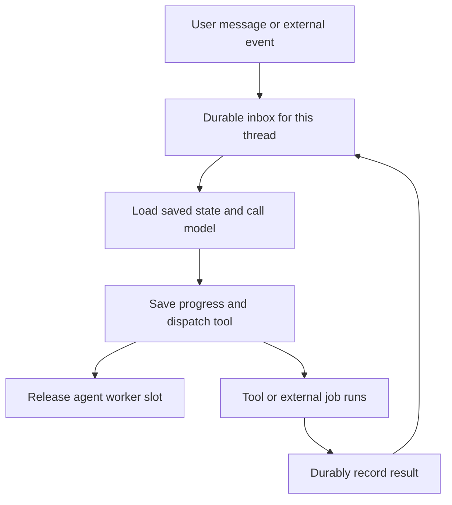

<!-- docs/research/infinity-agent-concurrency-2026-11-04.md -->
<!-- doc-status: point-in-time -->

# Infinity feasibility for BuildOS agent concurrency

November 4, 2026. Production measurements are from read-only Railway and Supabase queries that evening. Infinity source was inspected at commit `c1a7b05ef7f22774250218a623d6f2d692928a80` from November 3. The [baseline evidence](./infinity-agent-concurrency-2026-11-04.evidence.json) preserves the measurements and calculation assumptions.

**Recommendation: keep BuildOS's current chat runtime, use its existing concurrency headroom when demand warrants it, and prototype durable suspension for one background workflow.** Infinity is a feasible candidate for a separate experimental agent service. Replacing ordinary chat with it now would introduce substantial integration work for little demonstrated latency or infrastructure-cost benefit.

The attractive idea is making a waiting agent into stored state that can resume on any worker. That would help BuildOS support work lasting minutes, hours, or days, and coordinate independent research agents. Rust is one implementation choice; the same execution model can be implemented in TypeScript.

**What is running today.** These are current production settings, rather than defaults inferred from example environment files:

| Item                                             | Observed value                                                         |
| ------------------------------------------------ | ---------------------------------------------------------------------- |
| Chat service                                     | Dedicated Node.js service on Railway                                   |
| Region and replicas                              | Four running replicas in `us-west2`                                    |
| Concurrent turns                                 | Four per replica, 16 service-wide                                      |
| Reviewed code ceiling                            | Eight per replica, allowing a potential 32 service-wide                |
| Parallel tools                                   | Configured maximum of four per turn, subject to execution dependencies |
| Acting model                                     | `deepseek/deepseek-v4.1-flash`                                         |
| Turn timeout                                     | 360 seconds; provider budget 300 seconds                               |
| Chat-worker resource charges this billing period | $7.54 accrued in the October 7–November 7 UTC period                   |
| Previous full billing period                     | $7.80, September 7–October 7 UTC                                       |

Those Railway amounts cover the chat worker's CPU, memory, and egress. They exclude Supabase, model and tool charges, and the effect of workspace plan minimums and credits. The current $7.54 consists of $6.85 memory, $0.36 CPU, and $0.33 egress. Even removing the entire chat service would save at most roughly $8 per month at this level of usage, before replacement costs.

A quiet six-hour service-metrics window averaged about 708 MB across replicas and 0.018 vCPU. This is a useful idle baseline, not a capacity benchmark. Railway bills actual resource consumption; an 8 GB limit does not mean buying 8 GB continuously. Its public rate card is approximately $10 per GB-month of RAM and $20 per vCPU-month. [Railway pricing](https://railway.com/pricing), [resource-cost guidance](https://railway.com/guides/right-size-cpu-memory), [replica metric aggregation](https://docs.railway.com/observability/metrics).

**The current workload has little queue pressure.** The last 14 days contained 13 completed turns recorded as `live_ui` and `worker_realtime`, dated October 25 through November 3. Their median created-to-finished duration was 11.34 seconds and p90 was 58.79 seconds. Created-to-worker-start time was 0.471 seconds at the median and 0.555 seconds at p90. The maximum overlap of worker-start-to-finish intervals was one turn, against configured capacity of 16. These are server-side timestamps and do not include browser preparation before admission.

Twelve turns had provider-attempt observations. Summed provider durations were 88.7% of the corresponding worker wall-time sum. This is a directional indication that model work dominates; overlapping attempts mean it is not an exact partition of the critical path. Among 56 recorded tool executions, document-detail reads had a median of 383 ms, and three web searches had a median of 4.25 seconds. The median per-turn sum of observed tool durations was 1.57 seconds; concurrent tools can make the elapsed critical-path cost smaller.

The sample is too small to forecast launch traffic, but it gives no evidence that worker concurrency is causing today's slow replies. The older [October pipeline audit](../../docs/technical/reviews/AGENTIC_CHAT_PIPELINE_AUDIT_2026-10-17.md) also found model time dominant. Its historical flags and defects should not be treated as current; several have since changed.

**Three different kinds of concurrency matter.** Serving different users' chats concurrently, executing independent tools within one chat, and spawning several reasoning agents for one task solve different problems. BuildOS already does the first two. More worker slots help a queued user begin sooner. Parallel independent tools or agents can shorten one task's critical path. Suspending a waiting task primarily reduces resource occupancy and enables durable long waits.

The current [queue](../../apps/worker/src/lib/supabaseQueue.ts) starts jobs independently and refills a slot when its job promise finishes. An asynchronous network wait releases the JavaScript event loop, so other jobs can progress. It retains the logical job slot and reachable turn state. This is consistent with Node's normal asynchronous concurrency model. [Node.js event-loop guidance](https://nodejs.org/learn/asynchronous-work/dont-block-the-event-loop).

There is a second detail relevant to any refactor: the [provider-capacity lease](../../apps/worker/src/workers/agentic-chat/provider/turn-provider.ts) is acquired while preparing the turn and released with the provider turn state. It spans tool rounds; its `activeRequests` name should not be interpreted as a count of only live HTTP model requests. Releasing only the queue slot would therefore be insufficient to implement suspension correctly.

The [tool execution graph](../../apps/worker/src/workers/agentic-chat/tools/execution-graph.ts) already runs ready calls concurrently within a dependency layer. Infinity cannot claim the full benefit of parallel tools as a new gain over this implementation. The [concurrency ceiling](../../apps/worker/src/workers/agentic-chat/shared/concurrency-bounds.ts) is already eight. Its explanatory comment records an earlier mock load experiment, but the referenced load script is absent from this checkout; those results were not reproduced here.

BuildOS also has a [durable project-review workflow](../../apps/worker/src/workers/agentic-chat/workflow/README.md) with checkpointed planner, specialists, and editor steps. Its [specialist runner](../../apps/worker/src/workers/agentic-chat/workflow/workflow-runner.ts) runs two specialists concurrently on one path, and deliberately sequences them on the version-three path. These paths are gated. This gives BuildOS a place to try resuming a pending task without changing ordinary chat.

**How Infinity works.** Infinity is an Apache-2.0 Rust runtime from the Hydro project, introduced by AWS as an early research release. Its scheduling model turns agent execution into slices separated by tool-result messages. The headline of roughly 75,000 agents in 8 GB is a memory-density result using a simulated model, not a live-model throughput or chat-latency result. [AWS announcement](https://aws.amazon.com/blogs/opensource/introducing-infinity-a-runtime-for-extreme-agent-concurrency/).

The [benchmark source](https://github.com/hydro-project/infinity/blob/c1a7b05ef7f22774250218a623d6f2d692928a80/crates/infinity-agent-core/examples/agent_scale.rs) explicitly samples RSS after each wave's agents have become idle. Small scripted conversations, no external inference service, and idle measurements make it unsuitable for predicting BuildOS's active-turn capacity or savings. Finished BuildOS chats already live in the database without retaining a worker job.

To try Infinity itself without AWS credentials or inference charges, check out the inspected commit of the [upstream repository](https://github.com/hydro-project/infinity) and run a small version of that scripted exercise at its root with Rust installed:

```sh
AGENTS=100 TURNS=2 WAVE=10 cargo run --release -p infinity-agent-core --example agent_scale
```

This command is a suggested first exercise, not a benchmark performed for this report. The next useful experiment is a delayed external result with a worker restart; that tests a feature BuildOS would actually need.

A slice loads history, calls the model, saves the resulting state, dispatches an asynchronous tool, and yields. A result or other event enters the thread's mailbox and triggers another slice. Thread ordering protects conversation history; independent threads execute concurrently. Some synchronous tools can execute inline, so a slice is not an unconditional one-completion bound. [Runtime architecture](https://infinity.hydro.run/docs/infinity-runtime/architecture/).



The compute bill does not disappear everywhere in this diagram. A model completion still keeps the reference Lambda invocation active. Tool execution, inference, and persistent storage still cost money. A tool waiting on a callback can be cheap; a proxy that keeps an HTTP request open still occupies its own runtime.

The reference AWS deployment provisions an ARM Rust Lambda, input FIFO queue and dead-letter queue, output queue, delay relay, callback receiver, Aurora DSQL history storage, DynamoDB state storage, IAM permissions, and EventBridge schedules for long timers. Tools run separately and return callbacks. The CDK construct currently assigns 128 MB and a 15-minute timeout to the agent Lambda. [AWS architecture](https://infinity.hydro.run/docs/infinity-runtime/serverless/architecture/), [pinned CDK source](https://github.com/hydro-project/infinity/blob/c1a7b05ef7f22774250218a623d6f2d692928a80/agent/lib/infinity-agents/index.ts).

**Where speed gains would come from.**

| Change                                                     | Credible benefit                                                                                     | What it does not establish                                            |
| ---------------------------------------------------------- | ---------------------------------------------------------------------------------------------------- | --------------------------------------------------------------------- |
| Raise current four slots per replica to the reviewed eight | Up to twice the admitted simultaneous turns before adding replicas, if shared services have headroom | Twice the speed of an individual chat or twice sustainable throughput |
| Suspend ordinary chat during its current short tools       | Some reduction in retained state and occupied slots                                                  | A material reduction in model generation time                         |
| Suspend a 20-minute external wait                          | Much lower orchestration occupancy and no active agent invocation during the wait                    | Faster completion of the external work                                |
| Run independent research branches concurrently             | Shorter task critical path                                                                           | Lower token cost or improved answer quality automatically             |
| Rewrite runtime in Rust                                    | Potentially lower CPU and memory overhead                                                            | A known end-to-end speedup for this I/O-heavy workload                |

For an illustrative saturated worker, throughput is approximately available slots divided by average occupied seconds per task. If a task needs 20 seconds of active slice time and 80 seconds waiting on a genuinely external job, suspension can offer up to five times the slot capacity at the same active-worker budget, before queue/storage overhead and other limits. If almost 90% of its time is still in model calls that retain a slice, releasing the remaining portion offers only about 1.1 times the slot capacity under that simplified model.

For a separate illustration, three independent 20-second analyses plus 10 seconds of planning and synthesis take 70 seconds sequentially and 30 seconds concurrently: about 2.3 times faster. That benefit comes from task decomposition and parallel execution. A TypeScript coordinator can achieve it too. Dependency chains, shared-document conflicts, rate limits, and synthesis overhead reduce the gain.

For today's unsaturated ordinary chat, the planning assumption should be approximately zero inherent latency improvement from switching runtimes. Additional persistence and queue boundaries could increase latency. Actual performance needs an equal-model, equal-prompt, equal-tool comparison.

**Operating cost scenarios.** Infinity has no runtime license fee. The relevant bill is the sum of inference, tool services, runtime compute, queues, database activity/storage, logging, and network transfer.

The table below uses US East ARM Lambda pricing of $0.0000133334 per GB-second and assumes a total of 20 billed runtime seconds per completed user turn across all its slices. It excludes free-tier credits and every other cost category. The 128 MB column reflects the reference configuration; the 512 MB and 1 GB columns are sizing scenarios, not proven requirements. [AWS Lambda pricing](https://aws.amazon.com/lambda/pricing/).

| Completed turns per month | Runtime compute at 128 MB | At 512 MB | At 1 GB |
| ------------------------: | ------------------------: | --------: | ------: |
|                    10,000 |                     $0.33 |     $1.33 |   $2.67 |
|                   100,000 |                     $3.33 |    $13.33 |  $26.67 |
|                 1,000,000 |                    $33.33 |   $133.33 | $266.67 |

At four runtime invocations per turn, request charges add $0.08 per 100,000 turns before free-tier credits. Tool Lambdas and callback handlers add their own requests and duration. Long synchronous MCP calls can dominate those additional charges. AWS free allowances can reduce small-account charges, but may already be consumed by other functions.

SQS bills sending, receiving, deleting, and other actions, with 64 KB payload chunks affecting request counts. Four slices are not four total queue actions. Aurora DSQL's US East example prices are $8 per million DPUs and $0.33 per GB-month; DPUs are workload units, not SQL-query counts. DynamoDB, retained histories, backups, output delivery, and observability also need measurement. A whole-stack quote cannot honestly be derived from the Lambda table alone. [SQS metering](https://aws.amazon.com/sqs/pricing/), [DSQL pricing](https://aws.amazon.com/rds/aurora/dsql/pricing/).

The 13 recent BuildOS turns have $0.30514 of directly associated usage charges, including recorded search charges: mean $0.02347 and median $0.01024. This excludes unlinked preparation/background calls and is not a complete provider invoice. If that exact average workload mix repeated 100,000 times, those associated charges alone would be about $2,347. This is arithmetic sensitivity, not a volume forecast. Changing the runtime while keeping the same calls does not remove those charges. More agents can add prompts, duplicated context, retries, and synthesis calls.

The AWS reference [handler](https://github.com/hydro-project/infinity/blob/c1a7b05ef7f22774250218a623d6f2d692928a80/crates/infinity-agent-lambda/src/event_handler.rs) fixes the model to `global.anthropic.claude-sonnet-4-6` through Bedrock. BuildOS currently uses DeepSeek through OpenRouter. A fair cost experiment must preserve the model and its routing/privacy policy through an adapter. Infinity's core has a provider trait and a Rig bridge, so Bedrock is not a core architectural requirement. [Provider integration](https://infinity.hydro.run/docs/infinity-runtime/model-providers/).

**Integration effort is the expensive part.** The public quickstart is a small Rust/CDK application, requiring Rust tooling or Docker, pnpm, AWS deployment permissions, and model access. That gets a queue-driven agent running. It does not reproduce BuildOS's authorization, live previews, mutation review, usage accounting, cancellation, attachments, or recovery contracts. [Lambda quickstart](https://infinity.hydro.run/docs/infinity-runtime/serverless/quickstart/).

An Infinity service can remain separate from the existing TypeScript tools: call them over an authenticated internal API or a RAP adapter, and project events back into BuildOS's existing chat transport. A Rust worker on Railway could also use custom Supabase-backed stores. That preserves hosting familiarity but does not itself make an always-running container scale to zero; the application and queue still need suspension semantics.

The MCP bridge is useful for connectivity, but it exposes wrapper discovery/invocation tools, creates fresh cloud-side MCP sessions per invocation, and waits for the underlying synchronous call in its proxy. It can shift waiting costs rather than eliminate them. The existing curated BuildOS tool surface is worth preserving. [MCP compatibility](https://infinity.hydro.run/docs/rap/about/mcp-compatibility/).

Indicative engineering estimates below assume one experienced engineer, stable scope, and an existing BuildOS tool boundary. They are planning judgments, not measured implementation times or quotes:

| Option                                      | Effort estimate             | Added operations and best fit                                                       |
| ------------------------------------------- | --------------------------- | ----------------------------------------------------------------------------------- |
| Verify and tune existing chat concurrency   | Half a day to two days      | Existing stack; respond to measured queue pressure                                  |
| One TypeScript suspend/resume prototype     | Two to five days            | Existing queue and Postgres; one read-only background workflow                      |
| Harden that one workflow for production     | One to three weeks total    | Idempotency, retries, cancellation, deployment recovery, telemetry                  |
| Isolated Infinity proof of concept          | Two to five days            | Rust service, model adapter, one or two tools, mock comparisons                     |
| Broad Infinity replacement of ordinary chat | Four to eight or more weeks | Rust ownership, transport/store integration, feature parity, migration and rollback |

At an illustrative $100–$150 per engineering hour, four to eight 40-hour weeks represent $16,000–$48,000 of engineering time. Current chat-worker hosting savings cannot justify that by themselves. New long-running product capabilities or a demonstrated future scale constraint could.

**Risks that matter for BuildOS.**

- **Durable delivery requires more than stored conversation history.** At the inspected commit, `step_no_defer` saves history before dispatching the tool. A crash between those operations is a boundary that must be tested for lost dispatch. Output is also collected before publishing to the output queue. These are code-review concerns, not reproduced failures; require fault-injection evidence or add a durable outbox before relying on them. [Thread commit/dispatch code](https://github.com/hydro-project/infinity/blob/c1a7b05ef7f22774250218a623d6f2d692928a80/crates/infinity-agent-core/src/system/thread.rs#L564).
- **Ordered messages do not make external writes exactly once.** AWS explicitly documents at-least-once Lambda event-source delivery. Retain BuildOS mutation IDs, ownership fencing, write receipts, and uncertain-commit handling. Two child threads can still edit the same project record. [AWS SQS delivery semantics](https://docs.aws.amazon.com/lambda/latest/dg/with-sqs.html).
- **Defaults deserve an operations review.** The inspected construct sets both Lambda timeout and input visibility to 15 minutes. AWS recommends visibility at least six times function timeout for retry headroom. It is not proof the reference stack is invalid, but it is a concrete configuration gap to assess. [AWS queue configuration](https://docs.aws.amazon.com/lambda/latest/dg/services-sqs-configure.html).
- **Model compatibility needs direct validation.** An open November 3 report describes DeepSeek V4 tool-discovery and reasoning-history problems in a custom Infinity setup. This is one user report, not proof that BuildOS's exact DeepSeek route fails. It is directly relevant to the adapter test plan. [Issue 186](https://github.com/hydro-project/infinity/issues/186).
- **Cancellation and retries need fault tests.** Open reports describe CLI cancellation continuing in the background and a large-tool stream retry loop. Their existence does not establish the current Lambda behavior, but they argue against assuming mature operational semantics. [Issue 131](https://github.com/hydro-project/infinity/issues/131), [issue 98](https://github.com/hydro-project/infinity/issues/98).
- **Streaming parity is work.** The reference Lambda handler collects events and sends output after the step. BuildOS's live preview and durable event sequence need a custom observer/output integration. [Step-mode embedding](https://infinity.hydro.run/docs/infinity-runtime/agent-systems/step-mode/).
- **Callbacks and permissions outlive the original request.** Authenticate callbacks, bind them to the expected user/thread/tool and generation, reject stale results after cancellation, and recheck access before later writes. Additional transcript stores also need retention and deletion integration. RAP makes authentication implementation-specific and cancellation best-effort. [RAP specification](https://infinity.hydro.run/docs/rap/spec/overview/).

**The smallest useful BuildOS design.** Start with a background research or review task whose result can return later. Keep ordinary chat responsive and let it expose progress and eventual results. Use a short database transaction to record a checkpoint and pending dispatch together, release the worker claim, and enqueue a new ready step when the tool result arrives.

Persist the state needed for a correct continuation: conversation or history references, runtime/schema version, pending tool call IDs, dependency state, elapsed/spend budgets, authorization scope, reviewed decisions and mutation receipts, cancellation generation, and event sequence. A plain JavaScript Promise cannot be serialized into this continuation. The state machine must be explicit, or managed by a durable execution library.

Use separate limits for active model requests, tool execution, resident turn memory, and queued/suspended work. Do not count sleeping jobs as stalled workers; give waits their own deadline and recovery policy. Prefer callback-triggered resumptions to frequent polling. Limit child-agent depth and fan-out, coalesce noisy events before invoking models, and give interactive chats priority over background work. Begin with read-only child agents and one parent responsible for approved writes.

A comparison prototype should run the same synthetic delays and recorded/mocked tool results through the current path and the proposed durable path, at low concurrency and at a representative burst. Measure p50/p95 queue pickup, first-visible text, completion time, RSS per active turn, event-loop delay, database operations, provider calls, and total recorded cost per completed task. Inject worker termination after checkpoint/before dispatch, duplicate callbacks, callback-before-ack races, cancellation during a wait, revoked access, expired leases, and conflicting writes. A successful prototype must show recovery and no duplicated effects, not merely many sleeping agents.

Do not rerun a missing historical load script or increase production concurrency solely because a benchmark number exists. Use focused free local tests first. Any live model validation remains subject to the repository's per-run approval rule.

**Alternatives worth comparing if durable workflows become a product requirement.** AWS Lambda durable functions already offer TypeScript steps and waits, with checkpoint/replay and no compute duration charges while suspended. They still require AWS integration and replay-safe effects, but avoid a Rust agent-loop rewrite. [AWS durable functions](https://docs.aws.amazon.com/lambda/latest/dg/durable-functions.html), [supported runtimes](https://docs.aws.amazon.com/lambda/latest/dg/durable-supported-runtimes.html).

Inngest also offers TypeScript sleep, event waits, parallel steps, and saved step results; sleeping runs do not consume its concurrency allowance. Temporal is another option when workflow versioning, retries, signals, and operational visibility justify a dedicated orchestration service. Their pricing and execution models need a workload-specific comparison; neither makes running activities or model tokens free. [Inngest primitives](https://www.inngest.com/docs/durable-execution/primitives), [Inngest sleep semantics](https://www.inngest.com/docs/durable-execution/primitives/step-sleep), [Temporal pricing and capabilities](https://temporal.io/pricing).

The decision to revisit Infinity should be driven by a real long-running feature, sustained queue pressure after inexpensive tuning, or measured runtime memory costs at scale. With today's observed traffic and roughly $8 monthly chat-worker resource baseline, its architectural ideas are more valuable to BuildOS than an immediate runtime migration.

This investigation changed no application code or production settings, deployed nothing, and made no paid model/API test calls. Performance improvements and implementation timelines above are estimates; only the explicitly identified production baseline values are measurements.
