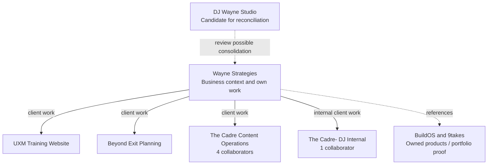

<!-- docs/research/project-evolution-and-workspace-organization-2026-09-29.md -->

# Evolving projects without losing their context

Research and design discussion, September 29, 2026. Prepared as a standalone handoff for an independent agent review. This is a proposal, not an implementation specification or an approved reorganization.

## Update, September 30: approved plan and build status

DJ approved a three-phase plan: parent holds and kids inherit, a "Shared with sub-projects" folder shelf, and the ambitious Organize view.

- **Phase 1 (nesting + shared shelf):** built and verified. Its database changes are live, including a hotfix for a one-hour document-load outage. The code is uncommitted.
- **Phase 2 (moves + Organize view):** handed to another agent.

Current status, decisions, file list, the Phase 2 brief and landmines are in [PROJECT_HIERARCHY_2026-09-30.md](../architecture/PROJECT_HIERARCHY_2026-09-30.md). That doc supersedes the sequencing below.

## Update, September 29 (after review): how the plan shifted

DJ was not sold on this plan. The review below replaces its recommendation and sequencing. The original text follows unchanged, for the record.

**What the review found in the live account and the code:**

- **The duplicate was not a lookup failure.**
    - Codex CLI, with all-projects access, created DJ Wayne Studio on 09-18 as "Samos — the Diagnosis and local client work". Its own description says "Tacemus, rebranding in progress", so the agent knew.
    - It created a new project because BuildOS has no "same business, next chapter" action.
    - On 09-28 a different Codex session renamed Tacemus → Wayne Strategies without noticing the sibling.
    - An identity resolver alone would not have prevented this.
- **Nothing can move between projects.**
    - No cross-project document move exists in the UI, chat or connector.
    - Task move exists in chat and the API only. It blocks any task with a start or due date, not only calendar-scheduled ones.
    - The connector has no move operation.
- **Name history already exists.** Every rename is in `onto_project_logs` (We Be Silent → Tacemus Website Design → Wayne Strategies). It just isn't searchable.
- **The Wayne map above is incomplete.**
    - Redline Training Company Website (Logan) is an active client that is missing.
    - Three creator-proposal projects were made by agents in July and have been idle since: Julian Dorey, Hannibal Is Hungry and Nomtastic Kim.
- **The live site depends on the Wayne ID.** The waynestrategies.com inquiry pipeline writes leads into project `f85b6c5f` with a project-scoped key, so Wayne Strategies must be the surviving ID.
- **Corrections to the capability table below:**
    - `project-cleanup.ts` is committed; only the tasker 112 doc is untracked.
    - Task move blocks all dated tasks.

**The new direction: three reversible moves instead of seven operations.**

1. **Fold into.** Every record of one project moves into another, with IDs intact. The source's document tree lands as a folder, and the source is archived with a forwarding pointer so old links and outside agents land in the right place. One-click undo comes from the stored list of what moved. The fold stops only on real conflicts, such as collaborators the target lacks or its own calendar.
    - Fold-into also covers merge, "retire", and turning a small project into a folder of docs.
    - Moving a whole project is the simplest transfer, not the hardest: nothing is left dangling, and undo moves the list back.
2. **Move** documents and tasks across projects from chat, the connector and the UI, including dated tasks.
3. **Nest** as an owner-set, private label: "part of" and "includes". It grants no access and is never a wall for search.

Supporting rules:

- **Undo instead of preview** for reversible moves. Review stays for destructive actions, such as archiving public pages.
- **Reconcile after folding** with the machinery that already exists: the per-project cleanup card (tasker 112) and the steward. Folding is how cross-project contradictions reach the tools that already resolve in-project contradictions.
- **At the outside-agent door:**
    - show similar existing projects on create and rename;
    - make former names searchable from the log;
    - forward folded IDs.
    - The identity resolver shrinks to this.

**Before building, measure whether structure helps search.** DJ likes the ambitious version (a drag-and-drop Desk, plus a workspace-wide tidy card). He asked whether the agent would find things more easily in a folded or nested structure. The test plan is in [project-structure-search-eval-2026-09-29/](project-structure-search-eval-2026-09-29/README.md): the 09-23 cross-project search eval, rerun on flat, folded, and folded + nested versions of the same snapshot with 27 questions. The paid run is Jev only, capped at $0.48, and waits for DJ's review of the questions.

Free findings already:

- **Search already walks a hierarchy** (project cards → up to 3 projects → records → sections). It reached the right project about 95% of the time on 09-23; the weak step is loading the right records (39–72%).
- **A folded Wayne sits near the in-project search ceiling:** an 80 KB request against an 88 KB bound. Fold-into needs a size check, or big projects need folders the finder ranks.
- **Outside agents' text search misses** misspellings ("Rod Chamberlain", "Phil Valeyo"), paraphrases ("consulting business") and old names ("Samos" finds nothing under Wayne). Giving the connector Jev-based search is likely the largest single search win, independent of structure.

**Eval result (09-29, $0.25 by balance change):**

- **Nesting labels were the largest search win.** On questions spanning Wayne and its clients, projects reached went from 60% to 94% and records named from 51% to 94%.
- **Folding fixed the one question where flat search never opened the twin** ("is samos the same as wayne strategies?"). Otherwise the flat search already found both twins. A folded Wayne reads a little shallower and is near the size ceiling.
- **Revised build order:**
    1. owner-set "part of" labels on project cards, where the card code is already written;
    2. fold-into for true twins only, with a size check;
    3. test letting a hub open its labeled clients on business-wide questions;
    4. separately, smarter connector search.
- Details and the click-through page are in the [eval README](project-structure-search-eval-2026-09-29/README.md#results-2026-09-29).

**Still DJ's call:** fold DJ Wayne Studio and the three creator proposals into Wayne? Which clients nest under Wayne? How much of the Desk UI to build now that the label carries the search win?

**The original problem and review purpose.** DJ uses BuildOS as an agentic work surface: conversations happen within projects, accumulate context, and should resume where earlier work left off. Project-focused retrieval has improved through Jev. However, work also arrives from ChatGPT, Claude, and other external agents. Those agents may create a project, update a different existing project, or use an earlier name for the same work. Over time, useful information and contradictory versions of current context accumulate across overlapping containers.

DJ wants the fluidity of reorganizing a desktop: combine related work, move records, retire obsolete containers, and promote growing workstreams into their own projects. Wayne Strategies, formerly Tacemus, is the motivating example: the ongoing business and its client engagements are spread across several projects. The request is to investigate the problem, examine current capabilities, compare abstractions, and brainstorm an approach. Implementation and changes to the account were not requested.

The central question for the reviewer is whether the proposed separation of identity, organization, ownership, and conversation scope provides the smallest sound foundation for that fluidity. Challenge the recommendation and its sequencing; do not treat it as an accepted architecture.

**Recommendation: make project boundaries revisable.** Preserve stable project identity and ownership, add lightweight relationships for organizing projects, and give the existing agent explicit operations for resolving identity, moving work, splitting projects, and reconciling duplicates. A user should be able to start with an imperfect structure and refine it as the work becomes clearer.

The core insight in DJ's request is that the structure of work emerges through doing it. AI makes capture cheap, across several agents and conversations; that creates a corresponding need for continuity and maintenance. Correct initial categorization cannot carry that whole burden.

**Evidence and limits.** I inspected the current checkout, including existing uncommitted work, and used read-only BuildOS calls to list 46 connector-visible projects, inspect four project-status packets, and list documents in Wayne Strategies and DJ Wayne Studio. This is not a full content audit of those projects. I did not mutate BuildOS data, run model evaluations, or verify deployed feature flags. Code findings describe the checkout; account findings describe the returned live records. All proposed relationships below remain hypotheses for review.

**The real example exposes several different problems.**

| Observation                                                                                                                                                                                    | What it suggests                                                                                                        | What it does not establish                                                                                           |
| ---------------------------------------------------------------------------------------------------------------------------------------------------------------------------------------------- | ----------------------------------------------------------------------------------------------------------------------- | -------------------------------------------------------------------------------------------------------------------- |
| Wayne Strategies has 29 tasks and 50 documents. Its current context records the September 28 name decision and domain purchase.                                                                | An existing canonical business identity to preserve.                                                                    | That every record in this project still belongs there.                                                               |
| DJ Wayne Studio has 14 tasks and 11 documents. Its context document is still titled “Samos — project context” and describes the same consulting business during an earlier naming/offer stage. | A strong candidate for identity reconciliation and selective consolidation.                                             | That the older prospect research or offer material is disposable, or that all offers were superseded by the rebrand. |
| The Cadre Content Operations has four collaborators; The Cadre- DJ Internal has one.                                                                                                           | Overlapping subject matter with a real sharing boundary.                                                                | That these are duplicates that should be merged.                                                                     |
| UXM Training Website and Beyond Exit Planning already exist separately; Wayne Strategies' description identifies the corresponding client work.                                                | A business overview should navigate and reason across client projects.                                                  | That all their tasks and documents should move into the business project.                                            |
| Wayne Strategies contains several Rod Chamberlin documents and multiple project-context documents, including an older Tacemus START HERE.                                                      | Work has already grown beyond its original home; both historical context and current authority need explicit treatment. | That title similarity alone proves duplication or obsolescence.                                                      |
| Wayne Strategies' description explicitly distinguishes BuildOS and 9takes as owned products used as portfolio proof.                                                                           | “Related to” and “client work under” have different meanings.                                                           | That every related project belongs under the same parent.                                                            |

**Four perspectives change the design.** DJ wants to resume the same real-world work without remembering its filing history. An outside agent needs to resolve the intended destination despite old names and limited access. A client collaborator needs shared work without exposure to private business notes. The implementer needs moves that preserve links, dependent records, and access checks. A folder hierarchy makes the first perspective visible; the other three are easy to overlook.

**Give each operation one clear meaning.**

| Operation                  | User meaning                                           | Result                                                                                       |
| -------------------------- | ------------------------------------------------------ | -------------------------------------------------------------------------------------------- |
| Rename / add a former name | “Tacemus is now Wayne Strategies.”                     | Same project ID; discoverable name history.                                                  |
| Group                      | “These client engagements sit under Wayne Strategies.” | Projects remain independently addressable and permissioned; an overview connects them.       |
| Combine context            | “Help me think across these projects.”                 | A bounded reading scope for this conversation; no ownership changes.                         |
| Reference                  | “Use the business's positioning document here.”        | A source link with access checks, rather than another independently edited copy.             |
| Move                       | “This proposal belongs in Beyond Exit Planning.”       | The record changes home with its dependent state accounted for.                              |
| Split / promote            | “This workstream has become its own project.”          | A selected set of work gains an independent context, with provenance back to its origin.     |
| Merge                      | “These two projects represent the same ongoing work.”  | One canonical destination, reconciled current context, retained sources, and old-ID routing. |

Synthesis is a reading/writing activity that can accompany any of these. An agent can write a cross-project synthesis without physically merging projects. Moving documents together also does not, by itself, reconcile contradictory claims.

**A proposed Wayne Strategies view.** The arrows below describe navigation and retrieval relationships. They do not grant access or transfer entity ownership.

Wayne Strategies should be able to hold its own brand, pipeline, goals, and business tasks while serving as an overview of client projects. A task can remain a task or a plan until it needs an independent context, lifecycle, or audience; nesting should not cause automatic proliferation of projects.

**The abstraction choice is consequential, but the vocabulary can wait.**

| Approach                                                           | Benefit                                                                         | Limitation                                                                                  |
| ------------------------------------------------------------------ | ------------------------------------------------------------------------------- | ------------------------------------------------------------------------------------------- |
| Improve search only                                                | Fastest improvement to finding scattered evidence.                              | Does not establish canonical identity, clean obsolete context, or prevent divergent writes. |
| Make every project recursively own all child work                  | Familiar navigation and an apparently universal container.                      | Couples hierarchy to access, lifecycle, rollups, context loading, and transfer semantics.   |
| Introduce areas, portfolios, initiatives, and projects immediately | Explicit distinctions between ongoing responsibility and finite outcomes.       | Large conceptual and migration cost before testing which distinctions users need.           |
| Keep projects and add explicit organizational relationships        | Preserves existing work and supports an inspectable hierarchy with cross-links. | Still requires clear rules for relationship ownership, visibility, and aggregation.         |

I favor the fourth option initially. Let an existing project act as a hub; add one primary organizational parent for a simple initial tree plus separate related-project links. Keep the relationship model extensible, but do not launch arbitrary graph editing or unlimited hierarchy as the first experience. Prevent parent cycles. Count a project or task only once in aggregate views. An ongoing hub's health should describe its business and engagements, not pretend the business becomes “100% complete” when current client tasks finish.

For personal organization, attaching someone else's shared project to my private hub should be a relationship I control, not a change to that shared project's global parent. If a grouping is shared, its visibility needs explicit policy. This may eventually justify a separate personal collection/area model. It does not justify recasting every current project now.

PARA's distinction between finite efforts and ongoing responsibilities supports treating Wayne Strategies as an ongoing area conceptually. It does not determine the database design. [Forte Labs' PARA description](https://fortelabs.com/blog/para/).

Linear separates project work from initiative grouping and supports nested initiatives, including multiple parents. This is useful precedent for a hierarchy being an organizational view rather than one exclusive ownership tree. [Linear initiatives](https://linear.app/docs/initiatives), [sub-initiatives](https://linear.app/docs/sub-initiatives).

Asana allows one task to appear in multiple projects with updates reflected everywhere. The transferable principle is one identity with multiple placements. BuildOS can begin with one owning project and references, without adopting task multi-homing's full editing and permissions complexity. [Asana multi-homing](https://help.asana.com/s/article/multi-home-tasks-to-avoid-information-silos?language=en_US).

**The code already supplies useful pieces.**

| Capability                         | Evidence in the checkout                                                                                                                                                                                                                                                                                                                                                                              | Implication                                                                                                                                                                                                                      |
| ---------------------------------- | ----------------------------------------------------------------------------------------------------------------------------------------------------------------------------------------------------------------------------------------------------------------------------------------------------------------------------------------------------------------------------------------------------- | -------------------------------------------------------------------------------------------------------------------------------------------------------------------------------------------------------------------------------- |
| Global semantic context selection  | [workspace.ts](/Users/djwayne/buildos-platform/packages/agentic-chat-runtime/src/context-finder/workspace.ts:85) ranks accessible project cards, zooms into at most three, or produces a pulse of up to eight. [Worker adapter](/Users/djwayne/buildos-platform/apps/worker/src/workers/agentic-chat/provider/chat-workspace-finder.ts:1) supports off/shadow/chips/on integration via configuration. | Reuse retrieval. Deployment configuration was not verified. A workspace audit needs explicit coverage beyond ordinary chat's bounded selection.                                                                                  |
| External project discovery         | [searchProjects](/Users/djwayne/buildos-platform/packages/shared-agent-ops/src/gateway/op-execution-gateway.projects.ts:92) matches substrings in names/descriptions.                                                                                                                                                                                                                                 | This MCP search path does not have the same semantics as Jev's global finder. Other search tools exist; this is a specific parity gap.                                                                                           |
| External project creation          | [createProject](/Users/djwayne/buildos-platform/packages/shared-agent-ops/src/gateway/op-execution-gateway.core.ts:1304) validates and instantiates the supplied project, then grants the caller access.                                                                                                                                                                                              | This entry path does not require an identity-resolution result before creation. Retry idempotency is distinct from detecting two agents independently describing the same business.                                              |
| Connector visibility limits        | [Scope note](/Users/djwayne/buildos-platform/packages/shared-agent-ops/src/gateway/op-execution-gateway.projects.ts:54) and [access policy](/Users/djwayne/buildos-platform/apps/web/src/lib/server/agent-call/project-access.service.ts:37).                                                                                                                                                         | “Not found” can mean outside this connector's scope. Preserve the existing access explanation; do not silently create a replacement or reveal hidden project details.                                                            |
| Cross-project task transfer        | [move_onto_task](/Users/djwayne/buildos-platform/packages/agentic-chat-runtime/src/catalog/definitions/ontology-write.ts:1127) and [atomic migration](/Users/djwayne/buildos-platform/supabase/migrations/20260713000000_add_atomic_cross_project_task_move.sql:58).                                                                                                                                  | Existing internal primitive preserves task identity/comments and previews lost relationships. It blocks schedules, recurrence, and assets. It is not a full graph transfer and is absent from this session's external tool list. |
| Project-local entity relationships | [Edge validation](/Users/djwayne/buildos-platform/packages/shared-agent-ops/src/gateway/op-execution-gateway.edges.ts:70) explicitly rejects cross-project endpoints.                                                                                                                                                                                                                                 | A project-relationship feature should have a deliberate separate contract, not simply remove this check.                                                                                                                         |
| Project schema                     | [onto_projects](/Users/djwayne/buildos-platform/packages/shared-types/src/database.types.ts:14935) has stable IDs, lifecycle, metadata, document structure, and access-related fields.                                                                                                                                                                                                                | I found no first-class parent, alias registry, or project-merge destination in the inspected schema/tool paths. Metadata alone would not create system-wide semantics.                                                           |
| Living cleanup proposals           | [project-cleanup.ts](/Users/djwayne/buildos-platform/packages/shared-agent-ops/src/project-cleanup.ts:1) and [Tasker 112](/Users/djwayne/buildos-platform/tasker/112-project-review-rollup-cleanup-change-set.md:1).                                                                                                                                                                                  | Existing uncommitted work offers a useful review pattern, but is per-project and must not be described as a deployed workspace organizer.                                                                                        |
| Global-chat memory attribution     | [globalAttribution.ts](/Users/djwayne/buildos-platform/apps/worker/src/workers/chat/checkpoint/globalAttribution.ts:1) declines ambiguous multi-project attribution.                                                                                                                                                                                                                                  | Broader reading scope needs explicit write destinations. Do not write every cross-project conversation back into every project's START HERE.                                                                                     |

**The first preventive tool should resolve identity.** A shared resolver used by internal chat and external agents should accept a known ID or a natural-language description, inspect accessible candidates, and return a structured outcome: resolved, ambiguous, no visible match, or incomplete visibility. Include the canonical ID, recognized name history, relevant evidence, and what was actually searched. Reuse Jev for semantic comparison; exact IDs and explicitly registered aliases can take deterministic fast paths. Never classify the meaning of prose with keyword lists.

Project creation should consume a fresh resolution result or an explicit “create separate work” choice. It should still support a legitimate new project with a similar name. A pending, unattached capture is preferable to inventing a project when the destination is unresolved. The agent should retain returned project IDs for follow-up calls.

Name history needs types: former public name, agent-facing label, and rejected/proposed name are not interchangeable. Tacemus has explicit evidence as a former identity; Samos appears in an older context and needs reconciliation. Alias collisions should return alternatives. A rename can preserve the previous name automatically, but a candidate branding idea should not silently become an authoritative identity fact. [Obsidian's aliases](https://obsidian.md/help/aliases) provide a simple precedent for alternate names without duplicating the underlying object.

**Make the organizer a workflow in the existing agent.** Start with a request such as “Organize my Wayne Strategies work.” The agent gathers the relevant inventory, proposes relationships and transfers, and renders a reviewable change set. It should explain which evidence supports “same work,” “client engagement,” “reference,” or “uncertain.” The server verifies IDs, authorization, versions, and operation support. This does not require a new autonomous-agent platform.

Proposed future tool responsibilities are resolve target, preview reorganization, apply the accepted change set, and inspect/revert supported changes. Each proposal should expose its actual operations instead of a vague “clean up everything” approval. Reuse shared operations across chat, UI, and MCP so the same action has the same semantics everywhere. Repeated review passes should revise one living proposal and remember rejected relationships, building on the current cleanup work when it is ready.

A first preview for this account would propose: keep Wayne Strategies as the business identity; compare DJ Wayne Studio's unique research and tasks for consolidation; connect client projects into the overview; preserve the Cadre sharing boundary; and examine Rod-related records for transfer or source references. It would not promise a complete merge based on metadata alone.

**A merge must reconcile meaning and state.** Combining two projects should select a canonical destination and designate one current orientation document. Preserve source documents and decision provenance. Establish which claims are current, explicitly superseded, unresolved, or historical. A later user decision can settle a name; a later timestamp alone does not prove an offer, fact, or commitment is more authoritative. Do not combine two “Thinking log” documents merely because their titles match.

The preview must account for goals, plans, milestones, risks, task links, document trees, comments, assets, events and recurrence, member/connector access, chat history, review jobs, and retrieval indexes. Selectively retained and intentionally omitted items must be visible. Copy-and-delete loops would break identity and lose dependencies. HubSpot's documented inability to unmerge is a useful caution about offering a merge without a recovery design. [HubSpot record merging](https://knowledge.hubspot.com/records/merge-records?app=1).

Use versioned previews, a manifest of affected IDs, and idempotent application. Revalidate permissions and source versions immediately before applying. Coordinate project write locks in a stable order so concurrent agent writes either happen before the snapshot or see the updated destination. Apply the supported database mutation atomically; queue external calendar/search effects with resumable, idempotent handling. Keep a durable operation journal and before-state for recovery. An undo can be exact only while later edits do not conflict; after that, offer a reviewed compensating operation rather than overwrite new work.

An old project ID should retain an authorized redirect/retirement record. Old links and outside agents must be able to discover the current home. Resolve the destination and check its permissions again; redirects never expand connector grants. Source history may require separate access checks. Disable competing active writes and duplicate review jobs for the retired project once consolidation has actually succeeded.

**Organization, retrieval, and permission must stay separate.** A hub can summarize authorized child projects on demand. Child chat can selectively retrieve relevant business context if that user or connector can access it. Reading a child does not automatically justify reading its siblings. Never inject an entire subtree into every prompt. Label the context used, retain source IDs, and report coverage when a broad request exceeds a chat budget.

A cached summary created for the owner can leak private child content if later shown to a collaborator. Summary storage must retain source/access provenance or be regenerated for the viewer's accessible set. Likewise, saving a synthesis into a shared hub can publish private source facts; that write needs a destination-audience check. Notion's inherited subpage permissions illustrate why adopting nesting also imports consequential access behavior unless deliberately separated. [Notion permissions](https://www.notion.com/help/sharing-and-permissions).

**Three testable routes.**

| Route                | Mechanism and first test                                                                                                                                            | Strongest objection / evidence against it                                                                                                                           |
| -------------------- | ------------------------------------------------------------------------------------------------------------------------------------------------------------------- | ------------------------------------------------------------------------------------------------------------------------------------------------------------------- |
| Identity first       | Give outside and inside agents the same resolver; test old names, misspellings, renamed projects, intentional similar projects, incomplete grants, and two writers. | If most fragmentation is intentional, resolution reduces accidental duplicates but leaves the main need untouched.                                                  |
| Organization first   | Preview Wayne Strategies with linked client projects and visible context scope; ask real business-level and client-level questions.                                 | If grouping saves no navigation or context work, a saved multi-project chat scope may be sufficient; a new permanent area type would be premature.                  |
| Reorganization first | Preview Studio-to-Wayne reconciliation and one transfer of a client workstream, then test supported apply/recovery on fixtures.                                     | If content conflicts dominate, building physical merge first just creates a larger inconsistent project. Invest in authoritative context and source tracking first. |

These are complementary routes, with a practical order: **show the real account preview, improve identity resolution, add reversible relationships, then implement bounded transfers and merges.** The preview tests the product idea before committing to a large schema. The first merge implementation should target compatible owner/access cases and reject unsupported dependencies explicitly; broader collaboration and integrations can follow.

**Questions the current evidence cannot settle.** Does DJ still treat the earlier Diagnosis offer as current, optional, or superseded? Which client-specific records are useful historical sources versus independently maintained duplicates? Should a shared hub's relationships be shared team structure or each person's personal organization? How often will people need multiple organizational parents? Those answers require reviewing source content and trying the proposed view, not a more elaborate ontology diagram.

**Decisive validation.** Use free fixtures and offline checks first. The important outcomes are fewer accidental creations, reliable resolution after renames/merges, lower effort to resume work, correct audience boundaries, preserved references, explicit conflict handling, and safe retry/recovery. Measure both broad-query coverage and irrelevant context loaded. Live model runs, if later useful, require explicit approval per AGENTS.md; none were run for this research.

**Answer to the initial abstraction-versus-tools question.** Establish stable IDs, explicit ownership/access boundaries, provenance, and structured mutation contracts early. Allow the organization of work to evolve through grouping, moves, splits, and merges. Users should not need to anticipate the final shape of a business or project when they first capture an idea. These tools should also improve future discovery, so a successful reorganization does not leave outside agents writing into retired contexts.

The upgraded product principle is: **start with the context you have; let BuildOS help evolve its organization while preserving identity, history, and control over who can see it.**

**Independent review brief.** Review this document and the referenced implementation as a design investigation. Account observations and code references are a September 29 snapshot; verify the current checkout before making implementation claims. Existing uncommitted work was present during the investigation and belongs to other ongoing work. Local file links assume the checkout at `/Users/djwayne/buildos-platform`; their paths after that prefix are repository-relative locations.

Please assess the following:

1. **Problem framing:** Are accidental duplication, intentional separation, historical evolution, and cross-project synthesis sufficiently distinct? Identify any missing user need that would change the design.
2. **Abstraction:** Compare an existing project acting as a hub with a separate personal collection/area. Pay particular attention to the unresolved tension between one primary parent and different users organizing the same shared project differently. Recommend the smallest model that supports the actual examples.
3. **Identity resolution:** Assess whether a shared resolver is the right first preventive investment. Examine search coverage, aliases, connector visibility, latency, and legitimate new projects with similar names. A completed lookup alone does not prevent two agents from concurrently creating the same new project; identify what additional coordination is warranted.
4. **Reorganization semantics:** Challenge the separation of group, reference, move, split, merge, and synthesis. Specify which should be possible first and which dependencies or conflicts should block application. Evaluate old-ID routing, current-context authority, source history, and realistic recovery after later edits.
5. **Access and memory:** Trace the two Cadre audiences through grouping, retrieval, generated summaries, saved synthesis, and merge. Check whether any proposed behavior could expose private information or wrongly capture a multi-project conversation into one project's memory.
6. **Reuse and implementation scope:** Verify the global finder, task move, external gateway, project schema, and cleanup proposal findings. Identify reusable mechanisms and missing contracts. Distinguish implemented code, deployed behavior, and proposed capabilities.
7. **First experiment:** Recommend one inspectable prototype using the Wayne Strategies example and explicit success/failure criteria. Determine whether it can validate the model before a database migration or physical merge is required.

Return a concise verdict; prioritized concerns with evidence; the recommended model and alternatives rejected; a smallest useful implementation sequence; and unresolved product questions that truly require DJ's judgment. State what evidence would change your recommendation. Keep account reorganization and implementation out of this review unless DJ separately requests them. Prefer free local inspection and offline fixtures; each paid validation run requires explicit approval under AGENTS.md.
