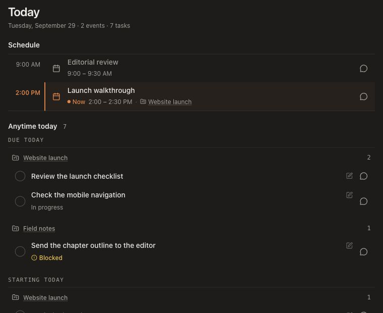

<!-- docs/research/youtube-library/analyses/2026-09-29_kole-jain_scannable-today.md -->

# Kole Jain: scannable interfaces applied to Today

Source: [The secret behind weirdly perfect UI designs](https://www.youtube.com/watch?v=neE6wOuBIP8), Kole Jain. Analysis: September 29, 2026.

Read the complete English auto-caption track directly from YouTube for this analysis. These are paraphrased notes, not a verbatim transcript. Auto-captions can contain recognition errors; the assessment of Today also used the live page and its source. No claim is made to have inspected every visual example in the video.

## Timestamped notes

- [0:00–2:03](https://www.youtube.com/watch?v=neE6wOuBIP8&t=0): Alignment creates structure. Arrange content and controls along shared edges before adding decoration or hiding actions.
- [2:04–3:09](https://www.youtube.com/watch?v=neE6wOuBIP8&t=124): Grouping makes dense information navigable. More whitespace alone can make an undifferentiated list longer.
- [3:10–4:28](https://www.youtube.com/watch?v=neE6wOuBIP8&t=190): Familiar visuals reduce reading, but ambiguous icons still need explanation. Recognition is the test.
- 4:29–5:15: Sponsor segment.
- [5:16–6:06](https://www.youtube.com/watch?v=neE6wOuBIP8&t=316): People arrive with a question and scan for its answer.
- [6:07–7:07](https://www.youtube.com/watch?v=neE6wOuBIP8&t=367): Emphasis is relative. Quiet defaults let a changed or important state stand out.
- [7:08–8:10](https://www.youtube.com/watch?v=neE6wOuBIP8&t=428): Shared columns and section boundaries can provide structure without nested cards.

## What this means for BuildOS

My application of those principles: Today should answer three questions quickly: what has a fixed time, what needs work today, and what changed while I was away? The existing schedule/anytime/changes split is a useful foundation. A wider redesign would weaken the experiment by changing too many things at once.

The live page had ten anytime tasks, each in a separate rounded card. Every task showed “In progress”; five belonged to the same project but were scattered through an alphabetical list. The repeated labels and card boundaries contributed little to finding a specific project. This is a problem with differentiation, not simply the number of tasks.

## First application

| Area            | Change                                                                                                                        | Reason                                                                                        |
| --------------- | ----------------------------------------------------------------------------------------------------------------------------- | --------------------------------------------------------------------------------------------- |
| Anytime tasks   | Keep due-today, starts-today, and in-progress buckets in that order; group each bucket by project ID.                         | A project grouping must not demote another project's deadline below undated work.             |
| Project context | One linked project heading per group, without a repeated count.                                                               | A stable scan target replaces repeated project names. Equally named projects remain distinct. |
| Task rows       | Replace filled, bordered cards with aligned rows and hover/focus feedback.                                                    | Titles and controls establish the reading edges.                                              |
| State           | Omit repeated in-progress metadata only inside its matching bucket; retain it elsewhere. Show blockers with an icon and text. | The shared heading supplies context; exceptional states stay explicit.                        |
| Schedule        | Preserve chronological order and the time rail. Give the current event a left rule, tint, and “Now” label.                    | Time remains a separate organizing principle, with redundant cues for the current state.      |
| What changed    | Remove its enclosing card while retaining project grouping and dividers.                                                      | The existing grouping already carries the structure.                                          |

Task completion, edit, chat, undo behavior, and the original task data continue through the existing handlers. No new API calls or language classification were introduced. Grouping uses structured bucket and project IDs. Completed tasks stay in their original location for the session, as before.

## Limits and design judgment

- This is a design hypothesis, not a measured usability improvement. Compare the time needed to locate a named task, find a project's work, and identify a blocker.
- Project headings add overhead when every project has just one task. Try both sparse and dense fixtures before making this a broad pattern.
- Quiet defaults must remain readable. Muted text is appropriate for supporting context, not the primary task title.
- Familiar icons help only if they are familiar to this audience. Keep descriptive accessible names and avoid new unlabeled glyphs.
- The global navigation, quick capture, onboarding, empty states, and backend scheduling rules are outside this first pass.

## Inspecting the result

The implementation is in `/today`. A development-only `/today/scan-preview` renders the real row, grouping, and change components with synthetic data. Completion and undo operate locally; edit/chat actions report the selected task; links are intercepted. It makes no live model calls. Its server loader returns 404 outside development.

## Validation

- Required `pnpm --filter @buildos/web check`: **0 errors, 0 warnings**, through `test-gate`.
- Focused `TodayTaskGroups.test.ts`: **2 tests passed**. Covers deadline precedence, distinct project IDs with identical names, no dropped tasks, selected task data in callbacks, completion/undo, and reactive regrouping.
- Official Svelte autofixer: no reported issues in the changed components. Its advisory suggestions about existing timer effects and copy-on-write collections were reviewed; those patterns remain intentional.
- Formatting and diff whitespace checks passed for the changed source files.
- Browser: inspected desktop and 390 CSS-pixel layouts in light and dark mode; mobile had no horizontal overflow. Exercised local completion, undo, detail, and chat callbacks. The live production page was inspected read-only; backend mutations and live model calls were not tested.
- Changes are local and have not been deployed. The preview uses synthetic data and the production components, with local callbacks in place of live actions.

Screenshots: [desktop dark](assets/today-scan-2026-09-29/desktop-dark.png), [desktop light](assets/today-scan-2026-09-29/desktop-light.png), [mobile dark](assets/today-scan-2026-09-29/mobile-dark.png), [mobile light](assets/today-scan-2026-09-29/mobile-light.png).

## Follow-up: aligned actions and fewer counts

Moved edit out of the task title into a shared horizontal action group with chat. Both controls use identical button and icon sizes. Removed the per-project counts in both the task groups and What changed.

Verified all seven preview task rows at desktop and 390px: edit/chat vertical centers match exactly, controls have equal dimensions, and mobile has no horizontal overflow. The relocated edit control opens the correct preview task. Required Svelte check: 0 errors and 0 warnings. Existing focused tests: 2 passed.

